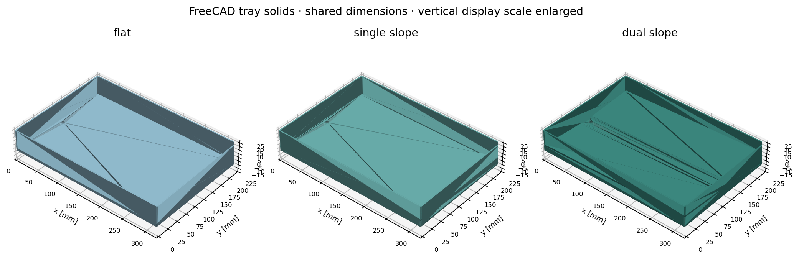
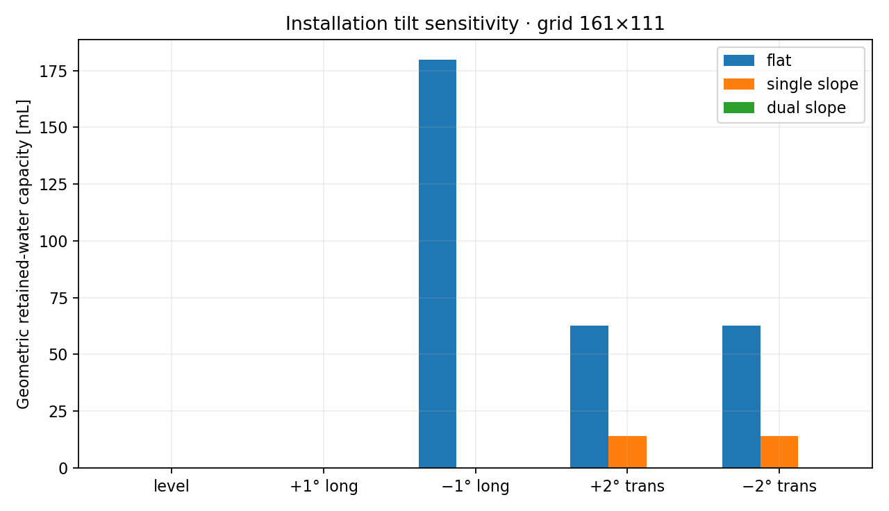
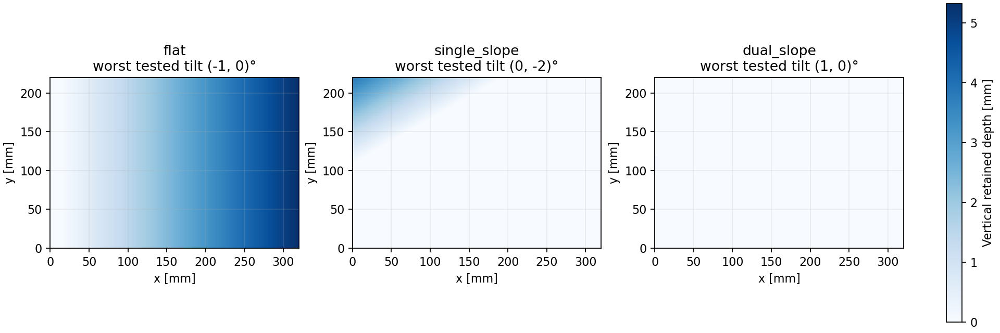

# DrainFlow

**Parametric condensate trays, geometric drainage connectivity, and design selection under installation tilt.**



A flat tray may look adequate when level yet retain water after a small installation error. DrainFlow compares flat, single-slope and dual-slope/channel trays using the actual parametric floor geometry, a gravity-potential height field, and a minimax escape-path calculation.

## Main result

Across level, **±1° longitudinal** and **±2° transverse** installation, worst modeled retained capacity is:

| Tray | Worst geometric retention | Checked CAD material volume |
|---|---:|---:|
| Flat reference | 179.8 mL | 199.99 cm³ |
| Single slope | 13.94 mL | 200.02 cm³ |
| Selected dual slope/channel | **below 0.02 mL** | 204.13 cm³ |

The selected thin-shell design uses **2% longitudinal slope, 4% transverse slope, an 18 mm channel, 1 mm recess, and an 8 mm outlet centered 10 mm from the end wall**. Its checked solid volume is about 2.1% above the flat reference.

These values describe geometric capacity after sufficient wetting and gravity drainage. Surface tension, films and roughness are excluded; the near-zero result is **not measured dry-out performance**. No physical test has been performed.



## Method

The floor is sampled from the same piecewise planar function used by the FreeCAD solid. Installation rotations change gravitational potential. A priority-flood/minimax graph calculation finds the lowest escape barrier to the outlet or rim, identifying depressions that a local gradient check would miss.

Retained volume integrates depth below each escape surface, with the rotation coordinate factor and drain opening accounted for. A separate ideal-orifice estimate, Q=Cd·A·√(2gh), evaluates an assumed outlet head; it is not a transient drainage simulation.

A bounded **162-combination sweep** screens both slopes, channel width/depth and outlet location. Five practical finalists are refined. Configurations within **1 mL** of the minimum worst-case retention are treated as equivalents before minimizing material and favoring cleanability. This avoids selecting a geometry based on sub-grid differences.



## Reproduce

Python 3.11 or later, from a checkout:

```bash
git clone https://github.com/guhanp09/drainflow.git
cd drainflow
python3 -m venv .venv
source .venv/bin/activate
python -m pip install -e '.[dev]'
drainflow
pytest -q
ruff check src tests scripts
ruff format --check src tests scripts
```

`drainflow --config configs/baseline.json --output results` regenerates the comparison, parameter search, depth/direction plots, grid study, selected geometry and [engineering report](results/report.md).

### CAD

```bash
docker build -t drainflow-cad .
scripts/cad.sh
drainflow
python scripts/render_cad.py
```

The second analysis includes checked CAD material volumes. The CAD-only image contains FreeCAD 0.20.2 and was exercised on Apple Silicon. The three `.FCStd` files expose editable dimensions and slopes; STEP is in mm and STL in m. Scale STL by 1000 for a millimetre-based slicer.

Floor surfaces are independently sampled from the solids and compared with the analysis height field. Section checks verify a minimum normal floor thickness of 2 mm. Native edit/reopen, valid-single-solid, STEP reimport and STL bounds checks accompany every export.

## Verification and limitations

**15 tests** cover a known trapped basin, a breached basin, rim escape, an analytical tilted-water wedge, symmetry, rotation, minimum thickness, outlet scaling, zero/negative head and invalid geometry. The selected design is checked on 81×55, 161×111 and 321×221 grids; its last refinement changes worst capacity by approximately **0.00073 mL**.

The five installation cases do not cover simultaneous two-axis errors or warpage. The model excludes contact-angle hysteresis, surface films, air locks, hose losses and clog formation. The approximate outlet estimate uses an assumed Cd of 0.62 at 5 mm head. It does not establish an emptying time.

The CAD uses an offset floor shell rather than a thick wedge. The channel shoulders have continuous planar ramps and external corners are filleted. Internal radii, draft, shrinkage and the real hose interface need review before molding. See [manufacturing and water-test guidance](docs/manufacture_and_test.md).

## Repository

- `src/drainflow/`: shared geometry, connectivity, study, and FreeCAD source.
- `configs/`: assumed dimensions, tilt cases and sweep bounds.
- `cad/exports/`: three editable solids, STEP/STL, drawings and checks.
- `cad/bom.csv`: basic tray/hose/test-fixture BOM.
- `results/`: comparison data, parameter search, selected design, figures and report.
- `tests/`: analytical and numerical verification.
- `docs/method.md`: equations, volume convention and algorithm reference.
- `examples/`: empty measurement template for future testing.

All baseline dimensions and coefficients are explicit engineering assumptions. Validate the printed/molded surface, water retention and service interfaces experimentally before release.

[MIT license](LICENSE).
